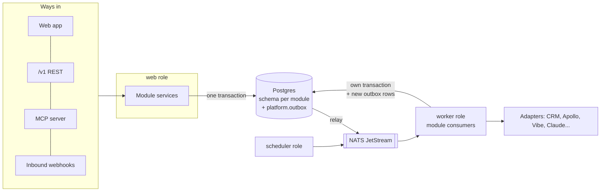

# Architecture

Cross-cutting rules every module follows. Module specs reference these instead of repeating them.

| File | Covers |
|---|---|
| [stack-and-layout.md](stack-and-layout.md) | Languages, frameworks, repo layout, processes |
| [module-boundaries.md](module-boundaries.md) | What a module is, how modules talk, how boundaries are enforced |
| [events-and-async.md](events-and-async.md) | Outbox, NATS JetStream, subjects, event envelope, retries, scheduling, rescoring |
| [data-conventions.md](data-conventions.md) | Tenancy in data, ids, money, time, provenance, deletion |
| [api-and-mcp-conventions.md](api-and-mcp-conventions.md) | REST `/v1`, auth, scopes, async pattern, errors, webhooks out, MCP |
| [deployment-and-iac.md](deployment-and-iac.md) | Container roles, compose, VM, Kubernetes, OpenTofu, secrets, observability |
| [design-and-copy.md](design-and-copy.md) | Palette, tokens, type, copy rules, value formatting |
| [event-catalog.md](event-catalog.md) | Every event type, funnel stage triggers, every MCP tool |
| [platform-stories.md](platform-stories.md) | Platform module epics and stories (outbox, scheduler, audit, health) |

Platform module (code PLT, schema `platform`) owns the outbox, processed-event records, scheduled job
definitions and the audit log. Its stories live in [platform-stories.md](platform-stories.md).

