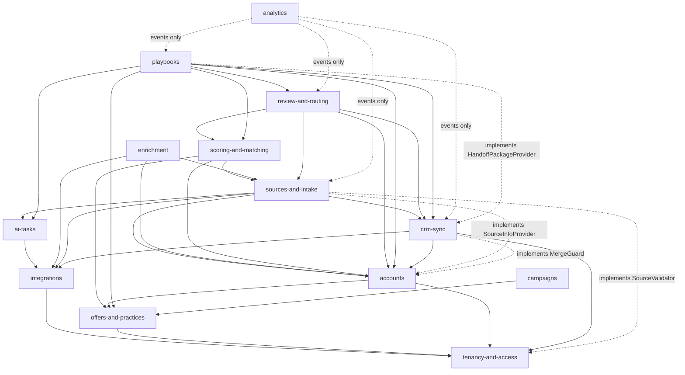

# Module boundaries (decision D9)

## Rules

1. **A module owns its schema.** Only the module's own code reads or writes tables in its Postgres
   schema. No other module queries them, joins them, or holds a foreign key into them.
2. **Cross-module references are ids, not foreign keys.** `playbooks.account_plan.account_id` is a
   plain id column. The owning module is responsible for keeping referenced ids valid and publishing
   an event when something is deleted or merged (`accounts.account.merged`), and dependants react.
3. **Two ways to talk:**
   - **Synchronous:** call the other module's public interface (`src/modules/<m>/index.ts`). Use it
     for reads you need now and for commands whose result you need now.
   - **Asynchronous:** publish an event; other modules consume it. Use it for anything that can
     happen after the user gets a response, and for every "something happened" fact.
4. **Public interfaces take a context.** Every call carries `ModuleContext { tenantId, actor,
   correlationId }`. A module never trusts a tenant id from its caller's arguments.
5. **Read models are allowed.** A module may keep its own copy of data it needs often (for example,
   Analytics keeps funnel facts built from events). Copies are rebuilt from events or from the owner's
   public interface; they are never written to by anyone else.
6. **Pure domain logic is separate.** Math and rules live in `domain/` with no database or network
   access, so they are unit tested and portable.

## Enforcement

- `eslint-plugin-boundaries` (or `dependency-cruiser`) in CI: a file in `src/modules/a/` may import
  only `src/modules/b/index.ts` and `src/modules/b/contracts/*`, never `b/db`, `b/services`, etc.
- Each module's Drizzle tables are declared with `pgSchema('<schema>')`. A CI check fails if a query in
  module A references a table object from module B.
- A Postgres role per module is optional for later; not required in R0.

## Dependency direction

Dotted "implements" lines are inverted dependencies (below), not calls: the lower module defines the
interface and never imports the higher one. ANL→SRC (`sourcesForAccount`) is a read through SRC's
public interface. API and MCP handlers sit above every module and may call any public interface (for
example `add_person` calls SRC `submitArrival`).

Arrows are synchronous calls. Everything else flows through events. Cycles are not allowed; if two
modules need each other synchronously, one of the directions becomes an event.

### Inverted dependencies

When a lower module needs data from a higher one, the lower module defines an interface and the
higher module implements it; the composition root (`apps/worker`, `apps/web`) wires them.

| Interface | Defined by | Implemented by | Used for |
|---|---|---|---|
| `HandoffPackageProvider` | CRM | PLB | Everything the CRM note and tasks need; CRM never imports PLB, SCO or OFF |
| `SourceValidator` | TEN | SRC | Checking a key's or grant's `source_id` exists |
| `SourceInfoProvider` | ACC | SRC | Trust for picking current fact values; sources for an account |
| `MergeGuard` | ACC | CRM | Refusing merges of accounts linked to different CRM companies |
| `ReviewStatusValidator` | SRC | REV | Checking that a source's `initial_review_status_key` names an active review status. With none registered, any key is accepted |
| `OwnershipPreflight` | REV | CRM (R1c) | Checking an assignment against the CRM. Results: `new` (not in the CRM; the default, with the message "New in the CRM"), `assign` (the seller can take it; says who had it), `stop` (open deal, customer or an owner we may not take over; only "keep their owner" goes ahead) and `blocked` (the seller has no CRM owner). R1c may keep the port or replace it with a direct call |

A module with no implementation registered (tests, stripped builds) falls back to a safe default
documented with the interface.

## Moving a module out

A module's spec (its index, epic files, contracts and events) plus its schema is the unit that can be
rebuilt elsewhere, for example inside Dayko in .NET. Because other modules only see its public
interface and its events, replacing it means re-implementing the interface (as an HTTP or NATS
request/reply service) and publishing the same events.
